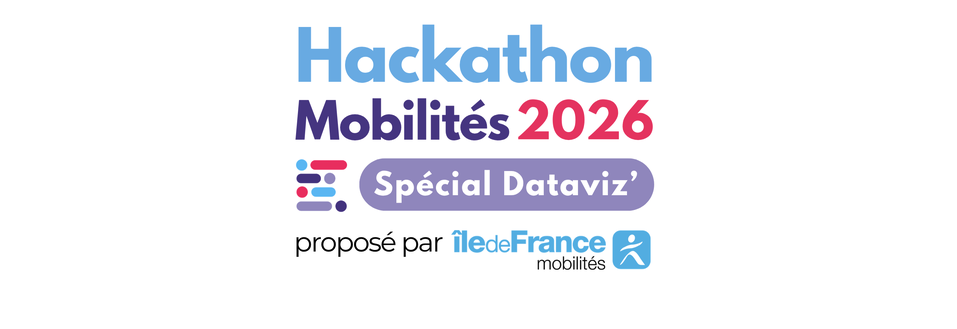
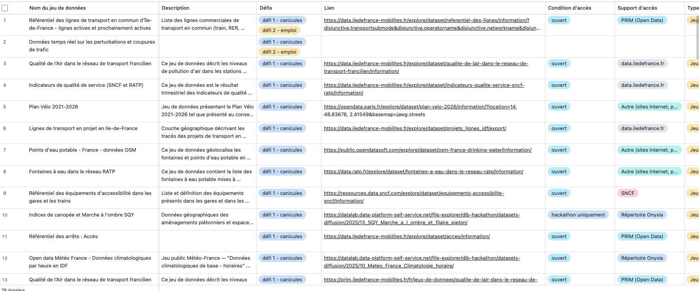
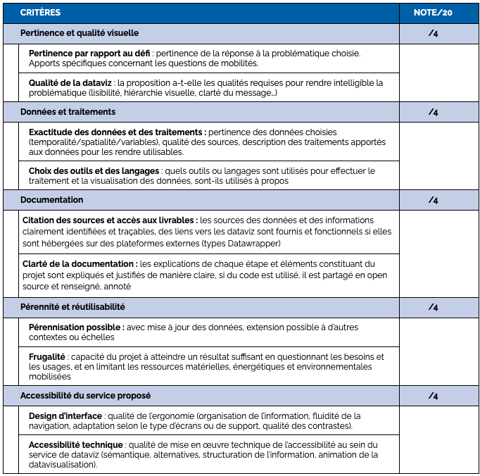
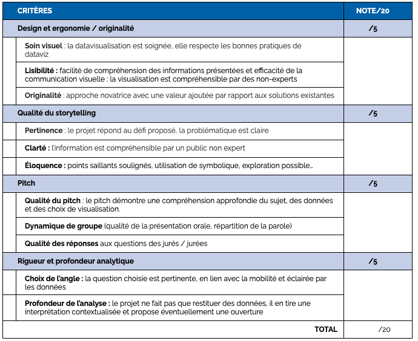

# Guide des participant·e·s au Hackaviz spécial Dataviz Challenge 2026

Bienvenue dans le Hackaviz Mobilités 2026 spécial dataviz organisé par Île-de-France Mobilités.

## _Hackaviz Mobilités spécial dataviz_

Après l’édition de 2024 portant sur l’usage de l’IA et l’amélioration des services de mobilité, après l'édition 2025 qui était axée sur la donnée au service d’une mobilité responsable (responsabilité environnementale, accessibilité…), le challenge de cette année 2026 vous propose un nouveau format avec un hackaviz qui place la visualisation de données au cœur du challenge. Autre nouveauté de cette édition, elle se déroulera à distance du 2 au 13 novembre, suivi d'une présentation des projets finalistes devant un jury à Paris le 26 novembre.

L’objectif cette année est de se concentre sur l'analyse et la visualisation des données afin de raconter une histoire et mettre en évidence des informations pertinentes. Il n'y a pas de format imposé. C'est la pertinence de votre angle, la qualité de votre démarche et la créativité de votre projet qui comptent. Vous pourrez créer une dataviz statique, interactive ou dynamique, ou même physique/sensorielle. 

Nous avons ainsi formulé plusieurs défis et mettrons à la disposition des candidats des données et ressources adaptées pour y répondre.

Cette année nous vous proposons 4 défis :
- **Défi 1** - Les mobilités et l’**adaptation climatique** 
- **Défi 2** - Les mobilités et l’**emploi** 
- **Défi 3** - Les mobilités et leurs **impacts sur le territoire** 
- **Défi 4** - Les mobilités et les **inégalités** (de genres, de revenus, de territoires)

Ce guide des participant.e.s vous aidera tout au long de ce Hackaviz et dans sa phase de préparation. 

## Sommaire

## Le programme

### Les 6 dates clés du challenge
1. Les pré-inscriptions sont ouvertes jusqu'au 8 octobre 2026
2. Jeudi 15 octobre de 12h30 à 13h30 : Webinaire de pré-lancement pour présenter le Hackaviz et les défis  
3. Lundi 2 novembre de 12h30 à 13h30 : Webinaire de lancement officiel avec les équipes 
4. Du lundi 2 novembre au vendredi 13 novembre 2026 à 18h : Challenge en équipe à distance
5. Jeudi 19 novembre 2026 de 9h à 12h : pré-sélection des projets assurée par le jury technique
6. Jeudi 26 novembre 2026 : présentation des projets sélectionnés en présentiel à Paris

## Les défis

Au cours de ces deux semaines de Hackaviz, vous relevez un défi en équipe. L'objectif est de proposer un projet qui répondre à un des 4 défis proposés. [Les défis sont présentés dans ce document](Docs/Présentation_des_défis). 

- **Défi 1** - Les mobilités et l’**adaptation climatique** 
- **Défi 2** - Les mobilités et l’**emploi** 
- **Défi 3** - Les mobilités et leurs **impacts sur le territoire** 
- **Défi 4** - Les mobilités et les **inégalités** (de genres, de revenus, de territoires)

## Les ressources et les outils

#### Le Slack

C'est sur le slack qu'auront lieu les principaux échanges ([lien d'invitation au slack]((https://join.slack.com/t/hackathonmobilits2026/shared_invite/zt-4dwa9podu-qfQVZRnOOYrL1J8oQDFYkQ ). Chaque canal possède une description dans un message épinglé.
- **00-tous-hackathonmobilités2026** : C'est ici qu'on vous transmet toutes les infos importantes sur le challenge
- **01-help-center** : Une question sur le challenge ? Posez là ici pour que la réponse puisse bénéficier à tout le monde
- **02-bourse-aux-equipes** : Si vous êtes en recherche de coéquipier·es avec lesquelles participer au challenge, venez faire un tour par ici 
- **03-la-machine-a-café** : N'hésitez pas à nous partager par ici vos avancées, ou les pépites que vous trouverez sans doute dans les données, ou juste de ressources ou des fun facts

Une fois ajouté sur le slack, **vous pouvez vous présenter dans le canal 02-bourse-aux-equipes** et échanger dans les canaux dédiés. 

Les équipes se composeront librement, mais les organisateurs se réservent les droits de rééquilibrer les profils et niveaux entre les équipes ! Une fois les équipes constituées, vous rejoignez le salon de votre équipe. C'est l'occasion pour commencer à mieux vous connaître et à échanger sur la découverte des ressources et données mises à disposition. 
 
#### Le répertoire de code

Chaque équipe aura son propre **répertoire de code public** (Github ou Gitlab) pour développer son projet. Vous pouvez cloner votre répertoire pour travailler dessus.

Deux choses : 
- Pour le README, veuillez [utiliser ce modèle](https://github.com/hackathons-mobilites/hackaviz_2026/blob/main/Docs/Template%20README%202026.md) (il vous servira pour l'envoi de votre projet à la fin du Hackaviz).
- Ajoutez le topic *hackathonmobilités2026* à la description de votre répertoire

##### Les données et documents

Pour entraîner vos algorithmes, visualiser des données, utiliser des APIs ou encore alimenter votre RAG nous avons sélectionné pour vous des **données et documents**. 

Ils sont accessibles ([depuis ce lien](https://airtable.com/appdkuZ71MaQ2sGyB/shrnHsc2C221uchRe)). Vous pouvez **filtrer les données sur le défi qui vous intéresse**. Certaines ressources sont issues du [Catalogue PRIM](https://prim.iledefrance-mobilites.fr/fr).

Vous disposez d'un certain nombre de ressources. **Le but n'est pas de toutes les consulter**, mais qu'elles puissent vous faire gagner du temps lors de la réalisation de vos projets. 

#### La documentation
Comme d'habitude, lisez les documentations en ligne des services utilisés, idem pour les jeux de données : un README par dossier associé !

## Vos résultats

### Publier vos réalisations
Vos projets viendront alimenter la communauté Data IA et mobilités. **Les réalisations seront publiées sous licences libres** (type MIT) et publiées sur **un répertoire de code public** (Github ou Gitlab). 

Concrètement, vous allez réaliser :
- le projet dans le répertoire de code public : des notebooks, applications, templates, jeux de données …. Le [modèle de README](https://github.com/hackathons-mobilites/hackaviz_2026/blob/main/Docs/Template%20README%202026.md) doit vous servir à documenter votre projet ;
- tout autre forme qui pourra valoriser votre projet

_Vous pouvez également joindre une courte vidéo de démonstration de votre datavisualisation, en particulier si celle-ci est dynamique ou interactive, afin d'en montrer les différentes fonctionnalités/interactions possibles_

**Les équipes sélectionnées présenteront leur projet au jury à l’oral le 26 novembre**, dans un temps limité. Vous aurez 4 minutes pour pitcher votre projet, suivies de 2 minutes de questions-réponses.

Rappel : 
- **Pour le README, veuillez [utiliser ce modèle](Docs/Template README 2026.md)** (il vous servira pour l'envoi de votre projet à la fin du Hackaviz.
- Ajoutez le topic *hackathonmobilites2025* à la description de votre répertoire (voir image ci-dessous)
- **Ajoutez le lien de votre répertoire** dans vos diapositives de pitch + vos canal slack en message épinglé

### L'accessibilité des datavisualisations

Vous trouverez des recommandations et éléments de réflexion, ainsi que de nombreuses ressources précieuses pour vous aider à soigner l'accessibilité de vos datavisualisations dans cette <a href="https://github.com/hackathons-mobilites/hackaviz_2026/blob/main/Docs/accessibilite.md">page dédiée</a>

### Les prix

- **🏆Premier Prix**
- 🏆Deuxième Prix
- 🏆Troisième Prix
- 🎉Prix spécial du jury

Voici la grille qui sera remise au jury technique (à titre indicatif, le jury est souverain dans ses choix !)

Et voici la grille d'évaluation du jury final (là encore le jury est souverain c'est donc à titre indicatif)

## Foire Aux Questions (FAQ)

Cette FAQ regroupe les questions les plus fréquentes ou susceptibles d’être posées par les participant·e·s du hackathon. Elle sera enrichie au fur et à mesure selon les besoins.

1. Quelles données seront accessibles pour ce hackathon ?

 
Les données utiles aux défis sont accessibles via ce <a href="https://airtable.com/appdkuZ71MaQ2sGyB/shrnHsc2C221uchRe">lien</a>. Vous aurez accès à des données déjà ouvertes et disponibles sur des portails open data, notamment le portail <a href="https://prim.iledefrance-mobilites.fr/fr/catalogue-data">PRIM</a>, mais également à des données exclusives au hackaviz. 

 

2. Les ressources mises à disposition par l’organisation seront-elles accessibles après le hackaviz ?

 
Les données ouvertes spécifiquement pour le Hackaviz ne sont pas encore à un niveau de qualité qui permet de les partager en externe. Elles ne seront donc plus utilisables au terme de l’événement. Mais l'objectif est de les ouvrir dans la foulée du hackaviz.

 

3. Peut-on participer au Hackaviz si on ne peut pas être physiquement présent·e à la présentation finale à Paris en cas de sélection ?

 
Non, il n’est pas possible de participer au hackaviz si vous ne pouvez pas physiquement être présent·e avec votre équipe à Paris le 26 novembre en cas de sélection. Il nous paraît important d’être ensemble pendant cet événement, et de favoriser des échanges interpersonnels physiques. De notre point de vue, quand on participe à un hackaviz, c’est aussi pour les rencontres qu’on peut y faire.

 

4. Comment puis-je trouver une équipe ?

 
La constitution des équipes s’effectue en amont de l’événement. Certaines équipes sont déjà constituées, d’autres pas encore. Nous organisons aussi un pré-lancement du Hackaviz en ligne pour que les participant·e·s puissent constituer leurs équipes. En effet, le 2 novembre de 12h à 13h, un rendez-vous en visio est prévu pour finaliser les équipes. 
 
Si vous n’avez pas d’équipe et/ou que vous n’avez pas pu assister lors du rendez-vous en visio du 2 novembre, nous vous recommandons de vous présenter dans le slack du Hackaviz et d’indiquer le défi qui vous intéresse le plus. Les échanges se font par ce canal. L’organisation aidera également à rapprocher les participant·e·s et les équipes en cours de constitution (n’hésitez pas à les contacter sur le slack dédié).

 

5. Comment rejoindre le Slack de l’événement ?

 
Pour rejoindre le slack, il suffit de suivre ce <a href="https://join.slack.com/t/hackathonmobilits2026/shared_invite/zt-4dwa9podu-qfQVZRnOOYrL1J8oQDFYkQ">lien</a>. Nous vous invitons à vous présenter dans le canal #02-bourse-aux-equipes. Vous y trouverez les autres participant·e·s et tous les échanges passeront par cet outil.

 

6. Où puis-je trouver les infos pratiques, les ressources et les liens du hackathon ? 

 
Vous trouverez le guide des participant·e·s sur notre <a href="xxxxxxx">GitHub</a>. Il contient les informations pratiques, la description des défis proposés… Bref, toutes les ressources dont vous aurez besoin !

