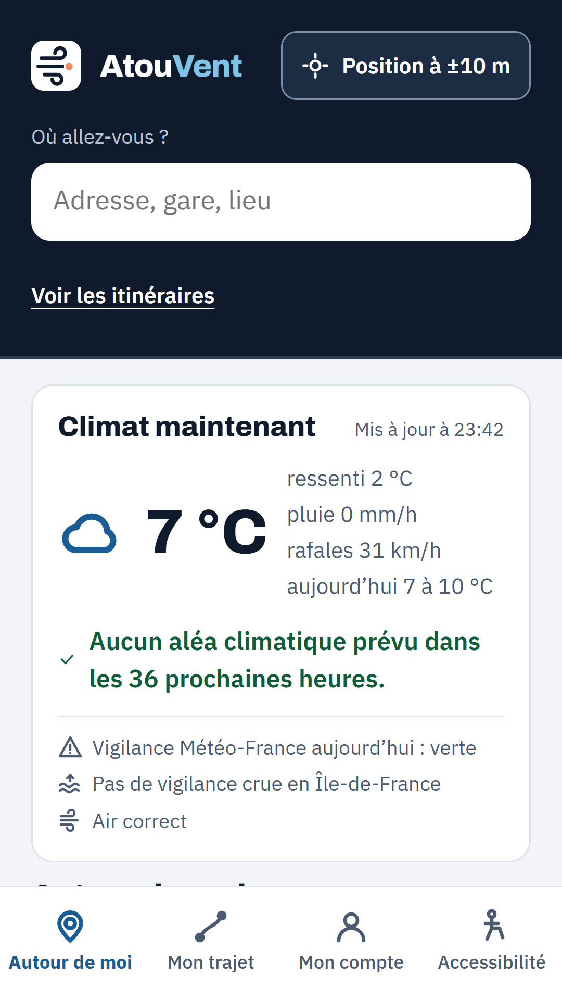
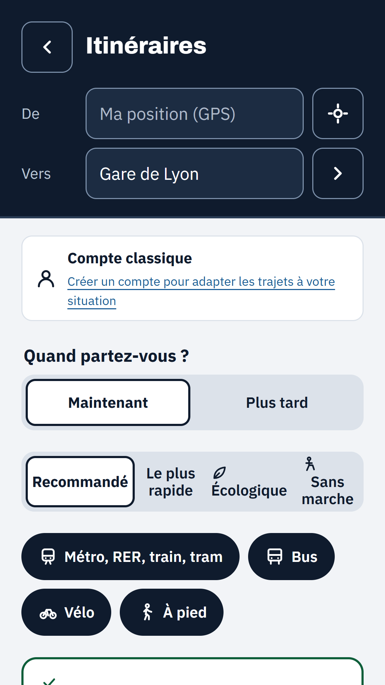
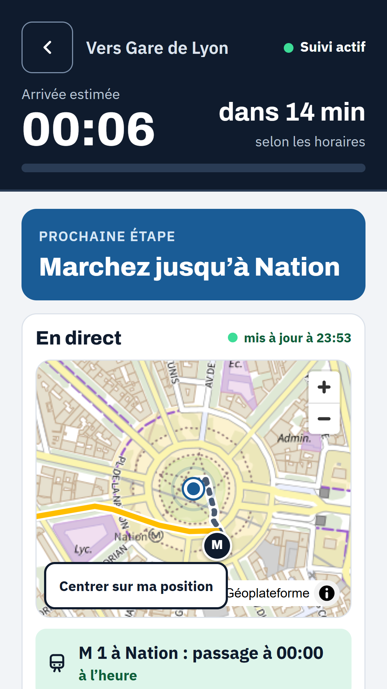
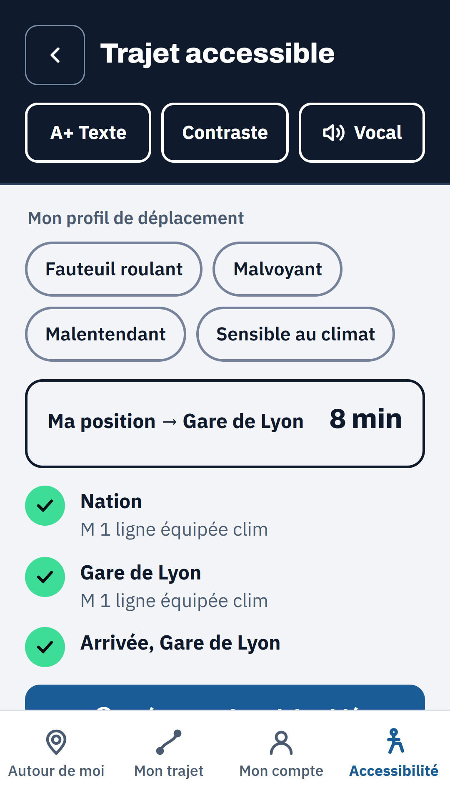

# AtouVent : se déplacer en Île-de-France malgré la chaleur

le code se trouve ici : **Resultats/Défi 1 - Les mobilités et l’adaptation climatique/defi-1_equipe-4_atouvent/production/atouvent**

**Équipe :** Brice Bokatola, William Laine
**Mail(s) de contact:** ebangarodmilson@gmail.com
**Défi :** Défi 1 — Les mobilités et l’adaptation climatique

  
  
  
  

## Notre question

Quand il fait très chaud, qui renonce à prendre le train en Île-de-France, dans quelles gares, et comment aider chaque
voyageur à se déplacer quand même, aujourd’hui et dans un climat à +2,7 °C ou +4 °C ?

Ce que montrent les données (juillet 2025 à juin 2026, 746 gares du réseau ferré, chaque jour comparé aux jours ordinaires
comparables, grèves écartées) :

- les jours à 33 °C et plus (13 jours ouvrés, dont la canicule du 17 au 27 juin 2026, 40,6 °C le 24 juin), les validations
  baissent de **6,9 %** ; à 38 °C et plus, de **13 %** ;
- la baisse est plus forte autour des gares des quartiers les plus modestes (**−8,6 %** pour le quart aux revenus les plus bas,
  **−5,3 %** pour le quart le plus aisé) ;
- à Trappes, station de référence TRACC, on passe de **13 jours** à 33 °C et plus par an aujourd’hui à **21 jours** à +2,7 °C
  et **34 jours** à +4 °C.

## Notre visualisation

**Application en ligne : [atouvent.com](https://atouvent.com)** (application web installable et Android).

- **Pour les voyageurs** : météo et vigilance, gares proches et lignes climatisées, points d’eau et lieux frais, itinéraires
  qui tiennent compte de la chaleur (ombre, climatisation, air des quais, accessibilité, ligne, direction et sortie), suivi
  du trajet avec annonces vocales, même sans réseau dans le métro. 5 langues, profils d’accessibilité (RGAA 4.1, niveau AA visé).
- **Pour les décideurs** : analyse de l’année 2025-2026 gare par gare (climatisation, îlots de chaleur, revenus), supervision
  en temps réel, prévision à 7 jours et « chaleur à venir » (+2,7 °C et +4 °C).

Fichiers déposés :

- `production/AtouVent-demo.mp4` : vidéo de démonstration (1 min 45, sous-titrée en français) ;
- `production/captures/` : écrans de l’application ;
- `docs/` : charte graphique, maquettes, flyer et planche RGAA issus de
  [Figma](https://www.figma.com/design/HscfdE8mqzpNKNbZaySCkB/AtouVent-%C2%B7-Charte--maquette-et-flyers).

Code source : [github.com/BriceBOKATOLA/atouvent](https://github.com/BriceBOKATOLA/atouvent).

## Les données utilisées

| Source | Jeu de données | Lien |
|---|---|---|
| IDFM | Validations par jour, réseau ferré (2025-2026) | [lien](https://data.iledefrance.fr/explore/dataset/validations-sur-le-reseau-ferre-nombre-de-validations-par-jour-3eme-trimestre-2025/) |
| IDFM | Référentiel des lignes (climatisation) | [lien](https://data.iledefrance-mobilites.fr/explore/dataset/referentiel-des-lignes/) |
| IDFM | Horaires théoriques GTFS | [lien](https://data.iledefrance-mobilites.fr/explore/dataset/offre-horaires-tc-gtfs-idfm/) |
| IDFM | Perturbations et prochains passages (PRIM) | [lien](https://prim.iledefrance-mobilites.fr/) |
| IDFM, Airparif | Qualité de l’air dans le réseau de transport francilien | [lien](https://data.iledefrance-mobilites.fr/explore/dataset/qualite-de-lair-dans-le-reseau-de-transport-francilien/) |
| IDFM | État des ascenseurs | [lien](https://data.iledefrance-mobilites.fr/explore/dataset/etat-des-ascenseurs/) |
| IDFM | Arrêts, zones d’arrêts, accessibilité en gare, fontaines aux arrêts | [lien](https://data.iledefrance-mobilites.fr/explore/dataset/accessibilite-en-gare/) |
| Météo-France | Données climatologiques quotidiennes et horaires | [lien](https://www.data.gouv.fr/fr/datasets/donnees-climatologiques-de-base-quotidiennes/) |
| ADEME, Météo-France | Données climatiques prospectives TRACC +2,7 °C et +4 °C | [lien](https://data.ademe.fr/datasets/donnees-climatiques-prospectives-france-4-vague-de-chaleur) |
| Institut Paris Region | Îlots de chaleur urbains, espaces verts ouverts au public | [lien](https://data-iau-idf.opendata.arcgis.com/) |
| INSEE | Filosofi, revenus carroyés 200 m | [lien](https://www.data.gouv.fr/datasets/revenus-pauvrete-et-niveau-de-vie-donnees-carroyees-2019-et-2021-dispositif-fichier-localise-social-et-fiscal-filosofi) |
| Ville de Paris | Îlots de fraîcheur, fontaines à boire, comptages vélo | [lien](https://opendata.paris.fr/explore/dataset/ilots-de-fraicheur-espaces-verts-frais/) |
| Vélib’ Métropole | Disponibilité en temps réel | [lien](https://www.data.gouv.fr/fr/datasets/velib-velos-et-bornes-disponibilite-temps-reel/) |
| Open-Meteo | Prévisions météo et qualité de l’air | [lien](https://open-meteo.com/) |
| IGN | Géoplateforme : fond de carte, géocodage, itinéraires piétons | [lien](https://geoservices.ign.fr/) |

Liste complète, avec licences et fréquences de mise à jour : `SOURCES.md` du dépôt de code.

## Les outils employés

- Analyse : Python, DuckDB
- Service : FastAPI, MongoDB, NumPy (calcul d’itinéraires par Connection Scan sur le GTFS)
- Interface : React, Vite, SCSS, MapLibre GL ; application Android avec Capacitor
- Conception : Figma ; présentation : Canva
- Hébergement : serveur Hostinger à Paris, Docker, nginx

## Licence

Ce projet est publié sous licence MIT (code source). L’analyse publiée dérive de bases sous ODbL et reste sous ODbL 1.0.
Les visuels (charte, maquettes, captures, vidéo) sont publiés sous licence Creative Commons CC-BY 4.0.
