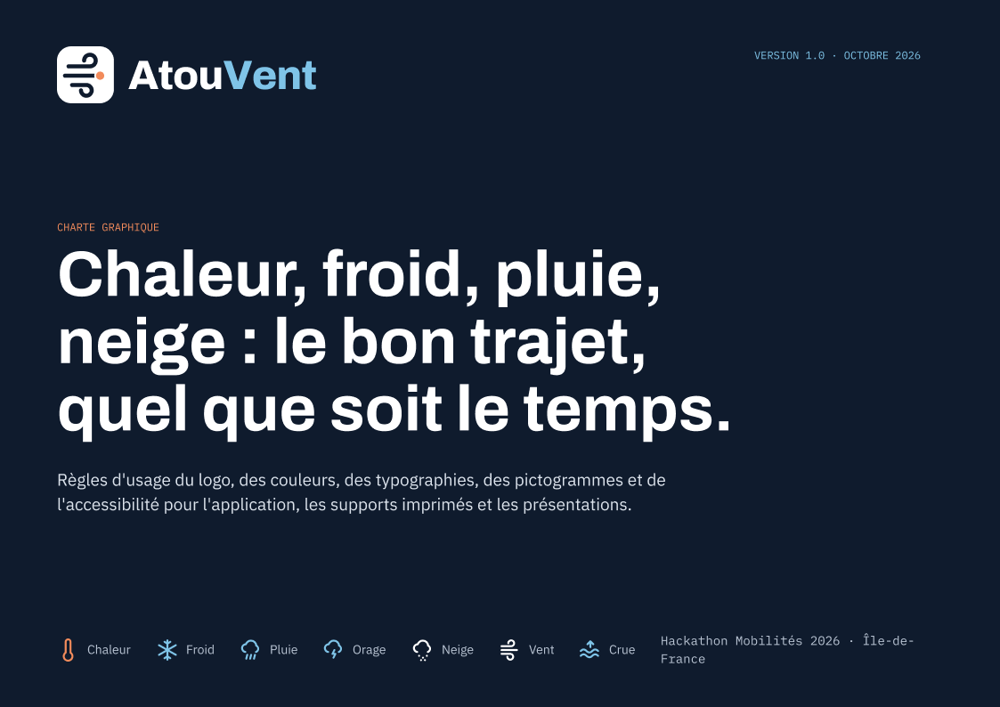
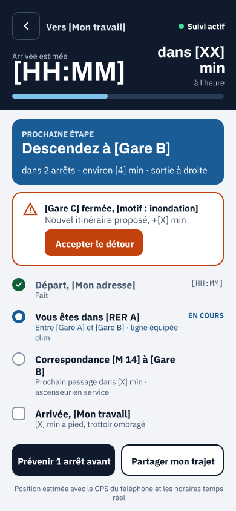
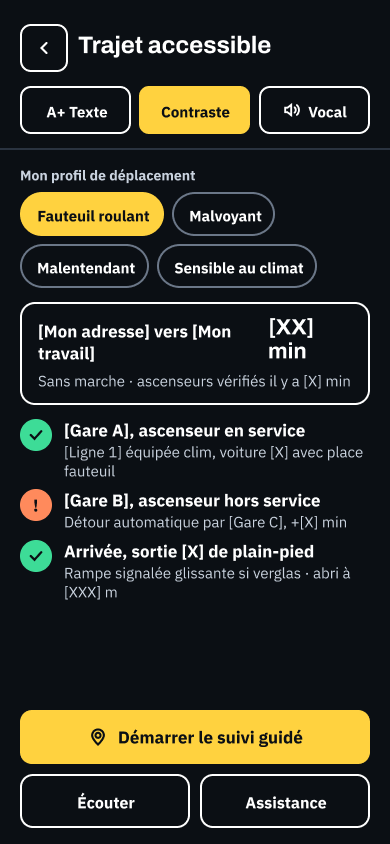
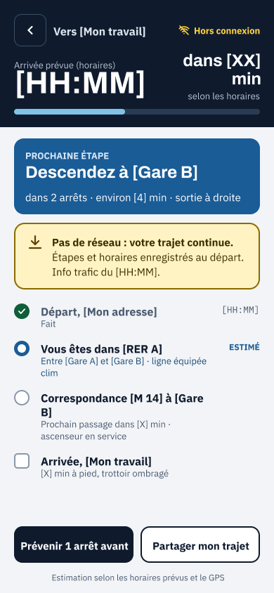
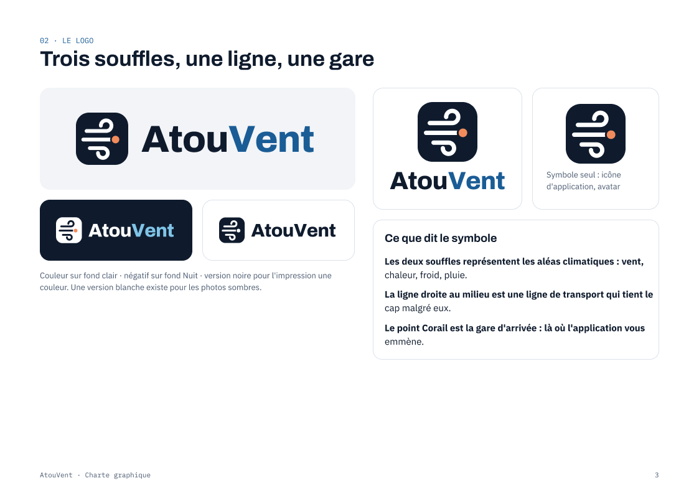
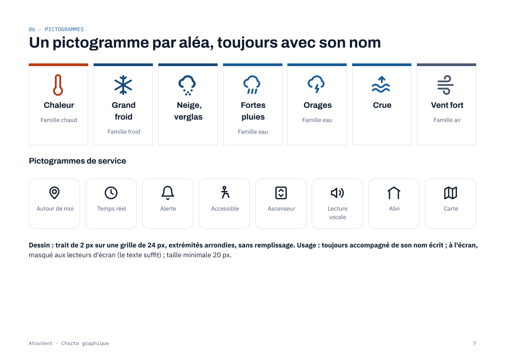
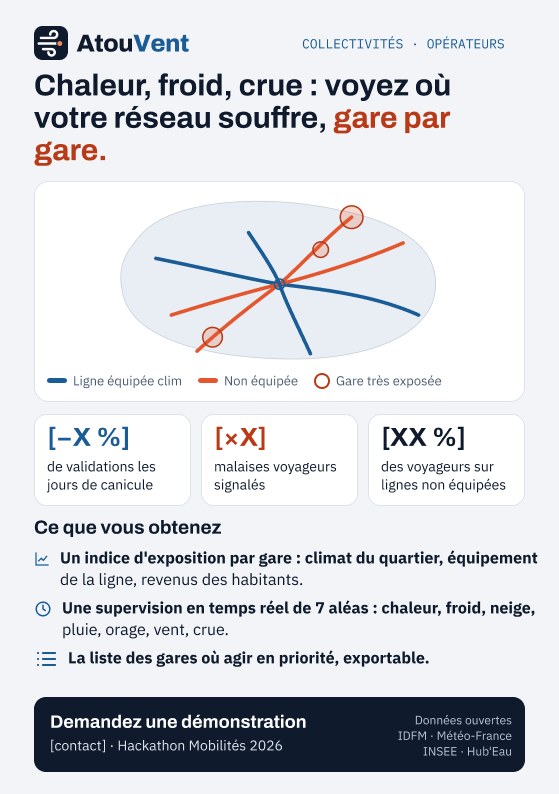
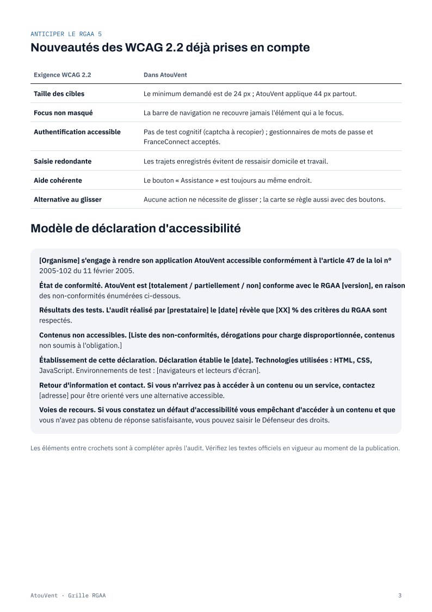

# AtouVent Maquette

Se déplacer en Île-de-France malgré la chaleur, les orages, le froid, la neige, le vent et les crues.
Application web installable (PWA, APK Android) et écrans pour les décideurs, réalisés pour le
**Hackathon Mobilités 2026 « Spécial Dataviz' » (Île-de-France Mobilités), défi 1 : canicules**, avec un regard sur les inégalités.

- **Maquette**

<p align="center">
  
</p>

<p align="center">
  
  
  
</p>

<p align="center">
  
  
</p>

<p align="center">
  
  
</p>

<p align="center"><em>Charte, maquettes, flyer et planche RGAA, tirés du fichier <a href="https://www.figma.com/design/HscfdE8mqzpNKNbZaySCkB/AtouVent-%C2%B7-Charte--maquette-et-flyers">Figma AtouVent</a> (dossier <code>design/figma/</code>).</em></p>

- Code : licence MIT (`licence.MIT`) · contributions : `contributing.md` · données et logiciels réutilisés : `SOURCES.md`
- Accessibilité visée : RGAA 4.1 niveau AA (contrôles automatiques dans `frontend/scripts/a11y/`)
- **Charte graphique : [Figma AtouVent](https://www.figma.com/design/HscfdE8mqzpNKNbZaySCkB/AtouVent-%C2%B7-Charte--maquette-et-flyers?node-id=0-1&m=dev&t=oiEklMA7Sf5s0VyM-1)** : le logo, les couleurs et la typographie. Le reste (maquette des écrans, flyers) est dans le fichier, en cliquant sur le lien.
- **En ligne : [atouvent.com](https://atouvent.com)** (site, API sur `/api`, application Android)
- Images Docker publiées dans **GitHub Packages** : `ghcr.io/bricebokatola/atouvent-api` et `ghcr.io/bricebokatola/atouvent-web`

## Liens

**Application** : [atouvent.com](https://atouvent.com) ·
[état du service](https://atouvent.com/api/v1/health) ·
[mentions légales](https://atouvent.com/mentions-legales.html) ·
[confidentialité et cookies](https://atouvent.com/confidentialite.html) ·
[déclaration d'accessibilité](https://atouvent.com/declaration-accessibilite.html)

**Dépôt au hackathon** : dossier `defi-1_equipe-4_atouvent` (équipe 4, défi 1), proposé au dépôt officiel par la
[demande de fusion n° 10](https://github.com/hackathons-mobilites/hackaviz_2026/pull/10) ; une fois acceptée, il se trouvera dans
[Résultats › Défi 1](https://github.com/hackathons-mobilites/hackaviz_2026/tree/main/Resultats/D%C3%A9fi%201%20-%20Les%20mobilit%C3%A9s%20et%20l%E2%80%99adaptation%20climatique).
Topic du dépôt : `hackathonmobilites2026`.

## Accès jury et administrateurs

- **Compte du jury** : `testtos407@gmail.com`, rôle **admin**, adresse déjà confirmée. Le mot de passe est transmis au jury
  directement (jamais écrit dans ce dépôt public).
- Connexion sur [atouvent.com/connexion](https://atouvent.com/connexion), puis **Mon compte** : boutons « Administration » et
  « Données ». Écrans décideurs (conçus pour un ordinateur) :
  [analyse 2025-2026](https://atouvent.com/donnees) ·
  [supervision en temps réel](https://atouvent.com/donnees/supervision) ·
  [prévision et chaleur à venir](https://atouvent.com/donnees/prevision).
- **Rôles** : un **admin** voit les écrans décideurs, les statistiques et l'état des collectes ; seul le **super admin**
  (adresse inscrite dans `SUPERADMIN_EMAILS`) voit la liste des comptes, le journal, change les rôles et supprime des comptes.
  Pour donner l'accès à quelqu'un : la personne crée un compte, puis le super admin la passe en admin dans « Administration ».
- **Adresse e-mail confirmée obligatoire** : à l'inscription, aucune session n'est ouverte ; un e-mail « Confirmer mon adresse »
  est envoyé (lien valable 48 h, renvoi possible depuis l'écran de connexion). Seuls le super admin et le compte du jury en
  sont dispensés.

**Sources de données** (licences et fréquences de mise à jour : `SOURCES.md`)

- Île-de-France Mobilités :
  [horaires GTFS](https://data.iledefrance-mobilites.fr/explore/dataset/offre-horaires-tc-gtfs-idfm/) ·
  [PRIM (temps réel, info trafic)](https://prim.iledefrance-mobilites.fr/) ·
  [référentiel des lignes (climatisation)](https://data.iledefrance-mobilites.fr/explore/dataset/referentiel-des-lignes/) ·
  [arrêts](https://data.iledefrance-mobilites.fr/explore/dataset/arrets/) ·
  [arrêts-lignes](https://data.iledefrance-mobilites.fr/explore/dataset/arrets-lignes/) ·
  [zones d'arrêts](https://data.iledefrance-mobilites.fr/explore/dataset/zones-d-arrets/) ·
  [état des ascenseurs](https://data.iledefrance-mobilites.fr/explore/dataset/etat-des-ascenseurs/) ·
  [qualité de l'air sur les quais (Airparif)](https://data.iledefrance-mobilites.fr/explore/dataset/qualite-de-lair-dans-le-reseau-de-transport-francilien/) ·
  [accessibilité en gare](https://data.iledefrance-mobilites.fr/explore/dataset/accessibilite-en-gare/) ·
  [fontaines aux arrêts](https://data.iledefrance-mobilites.fr/explore/dataset/fontaines-arrets-de-transport-en-commun-didf/) ·
  [parkings vélos](https://data.iledefrance-mobilites.fr/explore/dataset/parking-velos-ile-de-france-mobilites/) ·
  [parcs relais](https://data.iledefrance-mobilites.fr/explore/dataset/parking_relais_idf/) ·
  [toilettes RATP](https://data.iledefrance-mobilites.fr/explore/dataset/sanitaires-reseau-ratp/) ·
  [validations par jour, réseau ferré](https://data.iledefrance.fr/explore/dataset/validations-sur-le-reseau-ferre-nombre-de-validations-par-jour-3eme-trimestre-2025/)
- Ville de Paris :
  [fontaines à boire](https://opendata.paris.fr/explore/dataset/fontaines-a-boire/) ·
  [îlots de fraîcheur : espaces verts](https://opendata.paris.fr/explore/dataset/ilots-de-fraicheur-espaces-verts-frais/) ·
  [îlots de fraîcheur : équipements](https://opendata.paris.fr/explore/dataset/ilots-de-fraicheur-equipements-activites/) ·
  [sanisettes](https://opendata.paris.fr/explore/dataset/sanisettesparis/) ·
  [chantiers perturbants](https://opendata.paris.fr/explore/dataset/chantiers-perturbants/) ·
  [arbres](https://opendata.paris.fr/explore/dataset/les-arbres/) ·
  [comptages vélo](https://opendata.paris.fr/explore/dataset/comptage-velo-donnees-compteurs/) ·
  [comptages routiers](https://opendata.paris.fr/explore/dataset/comptages-routiers-permanents/)
- Météo et climat :
  [Météo-France, données quotidiennes](https://www.data.gouv.fr/fr/datasets/donnees-climatologiques-de-base-quotidiennes/) ·
  [données horaires](https://www.data.gouv.fr/fr/datasets/donnees-climatologiques-de-base-horaires/) ·
  [vigilance (portail API)](https://portail-api.meteofrance.fr) ·
  [TRACC +2,7 °C](https://data.ademe.fr/datasets/donnees-climatiques-prospectives-france-2-7-vague-de-chaleur) ·
  [TRACC +4 °C](https://data.ademe.fr/datasets/donnees-climatiques-prospectives-france-4-vague-de-chaleur) ·
  [Open-Meteo](https://open-meteo.com/) ·
  [Copernicus CAMS](https://atmosphere.copernicus.eu/)
- Eau et crues : [Vigicrues](https://www.vigicrues.gouv.fr/) · [Hub'Eau hydrométrie](https://hubeau.eaufrance.fr/page/api-hydrometrie)
- Territoire et société :
  [Institut Paris Region (îlots de chaleur, espaces verts)](https://data-iau-idf.opendata.arcgis.com/) ·
  [INSEE Filosofi, revenus carroyés 200 m](https://www.data.gouv.fr/datasets/revenus-pauvrete-et-niveau-de-vie-donnees-carroyees-2019-et-2021-dispositif-fichier-localise-social-et-fiscal-filosofi) ·
  [accidents corporels (BAAC)](https://www.data.gouv.fr/fr/datasets/bases-de-donnees-annuelles-des-accidents-corporels-de-la-circulation-routiere-annees-de-2005-a-2024/) ·
  [jours fériés](https://www.data.gouv.fr/fr/datasets/jours-feries-en-france/)
- Autres : [Vélib' Métropole](https://www.data.gouv.fr/fr/datasets/velib-velos-et-bornes-disponibilite-temps-reel/) ·
  [IGN Géoplateforme](https://geoservices.ign.fr/) ·
  [qualité de l'air en station (RATP)](https://data.ratp.fr/explore/dataset/qualite-de-lair-mesuree-dans-la-station-chatelet-2021-maintenant/) ·
  [assistance PMR en gare (SNCF)](https://ressources.data.sncf.com/explore/dataset/accompagnement-pmr-gares/) ·
  [Impact CO2 (ADEME)](https://impactco2.fr/) ·
  [Dispotrains](https://dispotrains.membrives.fr/) ·
  [OpenStreetMap](https://www.openstreetmap.org/copyright)

## Ce que fait l'application

**Pour les voyageurs**
- **Le climat d'abord** : température, ressenti, pluie, rafales, aléas à venir avec l'heure, vigilance officielle Météo-France, crue, air.
- **Itinéraires qui tiennent compte du climat** : métro, RER, train, tram, bus, Vélib' en direct, vélo, marche ; classement
  « recommandé », « le plus rapide », « écologique » (CO2 ADEME), « sans marche » (accessibilité vérifiée arrêt par arrêt).
- **Trajet à venir** : choisir une date et une heure de départ (jusqu'à 30 jours) ; la météo prévue à cette heure-là est
  récupérée automatiquement (jusqu'à 7 jours, sinon c'est dit clairement) et les aléas de ce moment changent le classement.
- **Air du quai** : niveau de pollution aux particules (évaluation Airparif, 665 quais) à chaque montée et descente, alerte
  « air très pollué » pour les personnes sensibles et les jours de pollution.
- **Lieux frais partout en Île-de-France** : îlots de fraîcheur de Paris et, hors Paris, 6 754 parcs, squares et bois ouverts
  au public (Institut Paris Region), avec la distance jusqu'à la lisière la plus proche.
- **Ascenseurs** : pannes réelles (arrêts de nuit à part) ; en « sans marche », un trajet qui évite la gare en panne est proposé.
- Fontaines, toilettes, parkings vélos, chantiers, signalements des voyageurs, suivi du trajet hors réseau (souterrain).
- Profils (fauteuil, marche difficile, malvoyant, malentendant, lecture difficile, sensible au climat), 5 langues (FR, EN, ES, IT, ZH),
  contraste renforcé, grand texte, voix, vibration.

**Pour les décideurs** (admins et super admin, `/donnees`)
- Analyse de l'année juillet 2025 à juin 2026 et de la canicule de juin 2026 : qui continue de prendre les transports, gare par gare.
- Temps réel : collecte, perturbations, ascenseurs, Vélib', état de chaque source de données.
- Prévision : 7 jours, fréquentation attendue, lignes à surveiller, et **chaleur à venir** (années types +2,7 °C et +4 °C, TRACC) :
  jours chauds par an et validations perdues gare par gare.

## Arborescence

```
├── analyse/                 préparation des données de l'analyse (Python, DuckDB)
│   ├── prepare.py               analyse complète → backend/data/chaleur.json
│   ├── projections.py           chaleur à venir (TRACC +2,7 °C et +4 °C) gare par gare
│   └── sources.py, social.py, accidents.py, air_quais.py, ascenseurs_chaleur.py
├── backend/                 API FastAPI + collecteur + MongoDB
│   ├── app/
│   │   ├── main.py              application, préfixe /api/v1, en-têtes de sécurité, compression
│   │   ├── core/                configuration (.env), MongoDB, sécurité (mots de passe, JWT, chiffrement du profil)
│   │   ├── routes/              un fichier par domaine (comptes, transport, environnement, ascenseurs, Vélib', admin)
│   │   ├── services/            une source ou un calcul par fichier (météo, air des quais, lieux, itinéraires, trafic…)
│   │   ├── router/              calculateur d'itinéraires sur le GTFS IDFM (Connection Scan) et sa préparation
│   │   ├── collectors/          collecte Vélib', ascenseurs, info trafic
│   │   └── worker.py            planificateur de collecte
│   └── tests/
└── frontend/                React 19 + Vite, PWA, Capacitor (Android)
    ├── scripts/a11y/            contrôles d'accessibilité (contrastes, audit, clavier) et captures d'écran
    └── src/
        ├── assets/scss/         styles SCSS (voir ci-dessous) · assets/fonts/ polices · assets/img/ logo
        ├── components/          composants réutilisables (components/data/ : graphiques et tableaux décideurs)
        ├── pages/               un dossier ou fichier par écran (trip/, settings/, auth/, data/)
        ├── features/            logique sans affichage (climat, lieux, trajet hors ligne, carte)
        ├── hooks/, context/     géolocalisation, réseau, flux en direct ; session, préférences, annonces
        ├── i18n/                textes en 5 langues (un test vérifie qu'aucune clé ne manque)
        └── api/client.js        client HTTP de l'API
```

### Styles (SCSS)

`frontend/src/assets/scss/main.scss` est le point d'entrée (importé par `src/main.jsx`) :

| Dossier | Contenu |
|---|---|
| `abstracts/` | points de rupture (`bp.up(lg)`, `bp.down(md)`) et mixins (bouton choisi, focus clavier, zone tactile, texte masqué) ; ne produisent aucune règle |
| `base/` | polices, **jetons de la charte** (`_tokens.scss` : couleurs des thèmes clair, sombre et contraste renforcé, en propriétés CSS pour changer de thème sans recompiler), remise à zéro, règles d'accessibilité |
| `layout/` | en-têtes, contenu, navigation basse (mobile) ou latérale (grand écran) |
| `components/` | un fichier par famille : boutons, cartes, formulaires, onglets, badges, bandeaux, retours d'état, liens, graphiques, contraste renforcé |
| `pages/` | règles propres à un écran |

Les couleurs ne s'écrivent qu'avec les jetons (`var(--…)`) : chaque couleur a été vérifiée à 4,5:1 pour le texte et 3:1 pour les contours, dans les trois thèmes.

## Lancer en local

Prérequis : Python 3.11, Node 22, MongoDB 8 (local ou `docker compose up -d` dans `backend/`), Google Chrome pour les contrôles d'accessibilité.

```bash
# API (port 8000)
cd backend
python -m venv .venv && .venv/Scripts/pip install -r requirements-dev.txt   # Linux/macOS : .venv/bin/pip
cp .env.example .env              # remplir JWT_SECRET et PROFILE_ENCRYPTION_KEY (obligatoires), clés PRIM/IDFM/Météo-France, SMTP
.venv/Scripts/python -m uvicorn app.main:app --port 8000
.venv/Scripts/python -m app.worker   # collecteur (autre terminal)

# Application (port 5174 ; /api est relayé vers le port 8000)
cd frontend
npm install
npm run dev                       # http://localhost:5174
```

Données à préparer une fois (gros fichiers, non versionnés, régénérés depuis les sources ouvertes) :

```bash
cd backend
python -m app.router.refresh --force   # horaires IDFM → data/router.npz (puis vérifiés chaque nuit par le worker)
python -m app.router.amenities         # équipements des arrêts, entrées de gare, fiabilité des ascenseurs
python -m app.router.shade             # ombre des arbres (Paris)
python -m app.router.hotspots          # points noirs piétons et cyclistes (BAAC 2021-2024)
cd ../analyse && python prepare.py     # analyse complète, dont la chaleur à venir (python projections.py : seule)
```

Super admin : mettre son adresse dans `SUPERADMIN_EMAILS` puis
`python -m app.admin_cli create-superadmin adresse@exemple.fr` (lien pour choisir son mot de passe ; `--no-email` l'affiche).

### Avec Docker (images de GitHub Packages)

```bash
cp backend/.env.example backend/.env   # remplir les secrets
docker compose up -d                   # site http://localhost:8080 · API, collecteur, MongoDB
docker compose up -d --build           # ou construire les images depuis ce dépôt
```

Chaque envoi sur `main` lance les tests (`.github/workflows/ci.yml`) puis, s'ils passent, publie les deux images dans
GitHub Packages (`.github/workflows/packages.yml`) : étiquettes `latest`, empreinte du commit, et numéro de version pour une
étiquette `v1.2.3`. Le site est servi par nginx (`frontend/nginx.conf`), qui relaie `/api` vers l'API sur la même origine.

## Tests et contrôles

```bash
cd backend && .venv/Scripts/python -m pytest      # API, calculateur, services, sécurité
cd frontend && npm test                           # logique de l'application, traductions complètes
# Test de bout en bout sur l'API lancée, avec 4 usagers types (classique, fauteuil, malvoyante, décideuse)
cd backend && .venv/Scripts/python scripts/scenario_usagers.py   # --keep : garde les comptes pour les contrôles d'écrans
# Accessibilité (application et API lancées ; TOKEN=jeton pour les pages connectées)
npm run a11y:contrast    # contrastes texte et contours, thèmes clair, sombre, contraste renforcé
npm run a11y:audit       # noms accessibles, images, titres, langue, cibles tactiles, erreurs, débordement
npm run a11y:keyboard    # tout est atteignable au clavier, focus toujours visible, pas de piège
```

Sous Git Bash (Windows), préfixer par `MSYS_NO_PATHCONV=1` les commandes qui reçoivent un chemin commençant par « / ».

## Accessibilité : check-list du hackathon

| Question | Réponse dans AtouVent |
|---|---|
| Informations indispensables faciles à repérer | climat en tête de l'accueil ; durée, horaires, aléas et accessibilité en haut de chaque trajet ; raisons de la recommandation écrites |
| Contraste texte / fond suffisant | ≥ 4,5:1 (3:1 grand texte) dans les 3 thèmes, contrôlé par `a11y:contrast` (0 défaut) |
| Contraste des pictogrammes et composants | contours et fonds des boutons, champs, puces ≥ 3:1 ; pictogrammes toujours accompagnés d'un texte |
| Compréhensible sans la couleur | chaque état est écrit (« Air du quai : pollution élevée », « Arrêt non accessible », « Vigilance orange ») ; barres de graphiques nommées une à une |
| Compréhensible si l'on ne voit pas certaines couleurs | palettes vérifiées pour le daltonisme ; scénarios de chaleur distingués par leur nom et leur valeur, pas seulement par la teinte |
| Alternative pertinente pour chaque image | pictogrammes décoratifs masqués (`aria-hidden`), logo avec `title`, cartes avec un titre et la liste des lieux en texte |
| Titre ou légende pour chaque graphique, carte, schéma | titres et légendes explicites ; chaque graphique a son tableau de valeurs (« Voir les valeurs en tableau ») et un export CSV |
| Lignes du réseau | chaque pastille porte le nom de la ligne (M1, RER A, T3a) ; la couleur officielle n'est qu'un repère en plus |
| Perturbations | gravité écrite en toutes lettres (« Trafic interrompu », « Perturbation ») avec un pictogramme, jamais un code rouge / vert seul |
| Utilisable au clavier seul | `a11y:keyboard` : 100 % des éléments atteints sur tous les écrans, focus visible, lien d'évitement en premier |

Déclaration d'accessibilité : `frontend/public/declaration-accessibilite.html`.

## Sécurité

- **Rôles vérifiés par le serveur** sur chaque route : compte connecté pour `/me…`, administrateur pour `/admin…` et
  `/collect/status`, super administrateur pour la gestion des comptes et la mise à jour des horaires. Les écrans protégés de
  l'application (`/compte`, `/admin`, `/donnees`) ne font que refléter ces règles : sans le bon rôle, l'API répond 401 ou 403.
- **Sessions** : jeton JWT signé (HS256 imposé), durée limitée (7 jours), révoqué partout au changement de mot de passe.
  Site web : le jeton vit dans un **cookie `atv_session` HttpOnly** (illisible par JavaScript), `SameSite=Strict`, limité à
  `/api`, `Secure` en HTTPS ; il n'apparaît jamais dans les réponses. Toute modification exige l'en-tête
  `X-Requested-With: AtouVent` (protection contre la falsification de requête). Application Android : jeton gardé par
  l'application et envoyé en `Authorization: Bearer`. Déconnexion : `POST /auth/logout` efface le cookie.
- **Cookies** : un seul, celui de la session, strictement nécessaire (exempté de consentement, CNIL) ; aucun cookie de
  suivi ni de mesure d'audience. Le détail de ce qui est gardé sur l'appareil est dans `frontend/public/confidentialite.html`.
- **Adresse e-mail confirmée avant toute connexion** : inscription sans session, lien signé réservé à cet usage (« verify »)
  (48 h, `/confirmer-email#jeton`, jeton retiré de la barre d'adresse) ; connexion refusée tant que l'adresse n'est pas
  confirmée (`403 email_not_verified`, seulement après le bon mot de passe), sessions plus anciennes refusées aussi ; renvoi du
  lien avec une réponse identique que le compte existe ou non ; le lien « nouveau mot de passe » confirme aussi l'adresse.
  Dispensés : le super admin (`SUPERADMIN_EMAILS`) et les comptes marqués confirmés (`email_verified`, compte du jury).
- Mots de passe hachés (scrypt) ; profil de déplacement (donnée de santé) chiffré en base et jamais exposé aux admins.
- **Anti-abus** : limite par adresse IP sur toute l'API (300 requêtes/min), plus stricte pour le compte, l'administration
  et le flux en direct, et par route (connexion, inscription, e-mails, itinéraires…) ; 20 essais de connexion par heure et
  par compte, quelle que soit l'adresse ; requêtes de plus de 1 Mo refusées.
- **En-têtes** : `X-Content-Type-Options`, `X-Frame-Options: DENY`, `Referrer-Policy`, `Cache-Control: no-store` sur les
  données personnelles, HSTS derrière HTTPS ; politique de sécurité du contenu (CSP) dans l'application construite
  (aucun script extérieur ni en ligne, seules les tuiles IGN et l'API sont joignables).
- **Configuration** : secrets uniquement dans `backend/.env` (jamais versionné) ; l'API refuse de démarrer sans
  `JWT_SECRET` et `PROFILE_ENCRYPTION_KEY` solides ; documentation `/docs` coupée par défaut (`ENABLE_DOCS=0`).

## Conception

La charte graphique est sur **[Figma](https://www.figma.com/design/HscfdE8mqzpNKNbZaySCkB/AtouVent-%C2%B7-Charte--maquette-et-flyers)** : le logo, les couleurs et la typographie. Le reste (maquette des 16 écrans, flyers, planches RGAA) se voit en ouvrant le lien ; `design/README.md` donne un lien direct vers chaque planche.
À l'ouverture, le logo se construit élément par élément puis le nom lettre par lettre (`components/Splash.jsx`,
`assets/scss/components/_splash.scss`), à chaque lancement de l'application ; passé d'un toucher ou d'une touche,
sans mouvement si « réduire les animations » est demandé.

## Base de données

MongoDB 8, base **`atouvent`** (26 collections, environ 80 Mo de données au 3 novembre 2026).

| Où | Emplacement |
|---|---|
| Sur cet ordinateur (service Windows « MongoDB ») | `mongodb://localhost:27017`, base `atouvent` ; fichiers dans `C:\Program Files\MongoDB\Server\8.0\data`, journal dans `C:\Program Files\MongoDB\Server\8.0\log\mongod.log` |
| Avec Docker | volume `mongo-data` du service `mongo` (`docker-compose.yml`) |
| En ligne | même chose sur le serveur d'atouvent.com, adresse donnée par `MONGO_URI` dans `backend/.env` |

Collections principales : `users` (comptes, profil chiffré), `velib_status` et `elevator_status` (historiques en séries
temporelles), `traffic_history`, `reports`, `collection_runs` (journal de collecte), `admin_log`, et les caches `*_cache`.
Pour la consulter : MongoDB Compass sur `mongodb://localhost:27017`. Les fichiers lourds du calculateur (horaires, équipements,
ombre) ne sont pas dans la base mais dans `backend/data/`.

## Données

Toutes les sources, leurs licences et leur fréquence de mise à jour : **`SOURCES.md`**. Points de méthode :

- **Analyse 2025-2026** : chaque jour est comparé aux jours ordinaires comparables (même jour de la semaine, même période scolaire,
  6 semaines au plus), grèves écartées. Méthode et limites en tête de `analyse/prepare.py` et affichées à l'écran.
- **Chaleur à venir** : années types TRACC à la station de référence de Trappes, comparées à l'année observée au même endroit ;
  validations perdues = validations d'un jour ordinaire × baisse mesurée à 33 °C et plus × jours ouvrés à 33 °C et plus.
  Gares écartées si leur fréquentation chute pour une autre raison (travaux, fin des cours universitaires). Un ordre de grandeur.
- **Air des quais** : évaluation Airparif publiée par IDFM, par quai et par ligne ; campagnes ponctuelles ou mesures permanentes.
- **Position en direct** : le GPS est suivi en continu ; la carte montre l'appareil (point bleu et cercle de précision) qui se
  déplace à chaque position, et les données autour (arrêts, Vélib', météo) sont rechargées après 100 m de déplacement.
  Pendant un trajet, chaque position est projetée sur le tracé : « vous avancez », « à l'arrêt », « vous revenez en arrière »,
  et l'arrivée est détectée sans attendre l'usager (`features/trip/motion.js`).

## Outils et langages

| Étape | Outil | Pourquoi |
|---|---|---|
| Analyse des données (`analyse/`) | Python, DuckDB | requêtes SQL directement sur les fichiers CSV et Parquet, sans serveur de base à installer |
| Service (`backend/`) | FastAPI, MongoDB | API rapide et typée ; séries temporelles natives pour les historiques Vélib' et ascenseurs |
| Calcul d'itinéraire | Python, NumPy (Connection Scan) | horaires GTFS compressés en mémoire, réponse en moins d'une seconde |
| Interface (`frontend/`) | React, Vite, SCSS, MapLibre | application installable (PWA) et Android ; cartes vectorielles sur fond IGN |

## Pérennité et frugalité

- **Mise à jour sans intervention** : horaires IDFM reconstruits chaque nuit ; Vélib' chaque minute, ascenseurs et trafic toutes
  les 5 minutes, crues toutes les 15 minutes ; l'état de chaque collecte est suivi (`/collect/status`, écran Supervision).
- **Réutilisable ailleurs** : le calculateur lit le format standard GTFS, utilisable pour un autre réseau ou une autre ville ;
  images Docker prêtes à déployer (`docker-compose.yml`).
- **Sobre** : un seul petit serveur suffit (environ 300 Mo de mémoire pour le calcul d'itinéraires, `--sans-bus` pour moins) ;
  pas d'apprentissage automatique lourd ; réponses mises en cache ; application utilisable hors connexion dans le métro ;
  analyses calculées une fois puis servies en fichier statique (`backend/data/chaleur.json`).

## Routes de l'API (`/api/v1`)

| Méthode | Route | Rôle |
|---|---|---|
| GET | `/health`, `/collect/status` | état du service et de la collecte |
| POST | `/auth/register`, `/auth/login`, `/auth/logout`, `/auth/forgot-password`, `/auth/reset-password` | compte (limité par IP ; session en cookie HttpOnly sur le web) |
| POST | `/auth/verify-email`, `/auth/resend-verification` | confirmation de l'adresse e-mail (obligatoire avant la connexion) ; renvoi du lien |
| GET, PUT, DELETE | `/me`, `/me/preferences`, `/me/export`, `/me/places…`, `/me/password` | profil, préférences, export et suppression (RGPD) |
| GET | `/geo/search?q=` | gares et stations du réseau d'abord, puis adresses et lieux (IGN) |
| POST | `/trips/plan` | itinéraires (`modes`, `accessible`, `walk`, `depart_at` pour un trajet à venir) |
| POST | `/trips/bundle`, `/trips/live` | paquet hors ligne avant le départ ; suivi en direct |
| GET | `/weather?lat=&lon=&at=` | prévision 7 jours, aléas, air ; `at` : conditions prévues au départ d'un trajet à venir |
| GET | `/stops/near`, `/places/near?group=`, `/cool/near` | arrêts (équipements, air du quai), lieux utiles, lieux frais |
| GET | `/departures/{ref}`, `/traffic`, `/stream` | prochains passages, info trafic, flux en direct (SSE) |
| GET | `/elevators`, `/elevators/summary`, `/velib/near`, `/velib/history` | ascenseurs, Vélib' |
| GET | `/flood`, `/rivers`, `/seine` | vigilance crues, hauteur des rivières |
| GET, POST | `/reports/near`, `/reports`, `/reports/{id}/vote` | signalements des voyageurs |
| GET, PUT, DELETE, POST | `/admin/…` | analyse, santé des données, synthèses, comptes et rôles (admins, super admin) |

## Application Android (APK)

L'application Android (Capacitor, `com.atouvent.app`, Android 6 et plus) embarque le site et appelle l'API **en ligne**
(`frontend/.env.android` : `https://atouvent.com/api/v1`). Elle ne fonctionne donc qu'une fois atouvent.com en ligne
(section suivante) : tant que le domaine affiche la page d'attente de l'hébergeur, l'application indique « Pas de réseau ».

| Commande (dans `frontend/`) | Résultat |
|---|---|
| `npm run android:apk` | APK de test à installer sur un téléphone : `android/app/build/outputs/apk/debug/app-debug.apk` |
| `npm run android:release` | Play Store : `android/app/build/outputs/bundle/release/app-release.aab` (et un APK signé) |
| `npm run android:open` | ouvre le projet dans Android Studio |

- Java 21 : celui d'Android Studio est pris automatiquement.
- **Signature Play Store** (une seule fois) : créer la clé avec la commande `keytool` indiquée dans
  `android/keystore.properties.example`, puis copier ce fichier en `android/keystore.properties` et le remplir.
  La clé et ses mots de passe ne sont jamais versionnés ; les perdre empêche toute mise à jour sur le Play Store.
- **Play Store** : textes, réponses aux questionnaires (sécurité des données, contenu), icône, bannière et captures
  dans `play-store/` (`play-store/fiche.md`). Application ciblant Android 16 (API 36), exigé par Google depuis août 2026.
- À chaque nouvelle version : augmenter `versionCode` (et `versionName`) dans `android/app/build.gradle`.
- Permissions demandées : position (itinéraires et suivi du trajet), vibration (alertes), état du réseau (mode hors ligne).
- Le suivi du trajet ne démarre que lorsque le téléphone s'éloigne d'au moins 40 m de l'endroit où l'usager attendait
  (partout en Île-de-France) ; bouton « Je pars maintenant » sans GPS. GPS refusé ou hors région : suivi par les horaires.

## Mise en ligne (atouvent.com)

Sur un serveur avec Docker (VPS, 2 Go de mémoire suffisent), ports 80 et 443 ouverts :

1. Chez l'hébergeur du domaine (Hostinger, zone DNS) : enregistrements **A** `atouvent.com` et `www` vers l'adresse IP
   du serveur (à la place de la page d'attente).
2. Sur le serveur : cloner le dépôt, copier `backend/.env.example` en `backend/.env` et le remplir (secrets, clés,
   `APP_URL=https://atouvent.com`, `CORS_ORIGINS` avec `https://localhost` pour l'application Android), puis copier
   `backend/data/` (horaires et fichiers lourds, non versionnés).
3. `docker compose -f docker-compose.yml -f docker-compose.prod.yml up -d`
   → Caddy obtient le certificat HTTPS tout seul (`deploy/Caddyfile`) ; site, API et flux en direct sur atouvent.com.
4. Vérifier : `https://atouvent.com/api/v1/health` doit répondre `{"ok":true,…}`.

**Horaires IDFM** : IDFM ne publie que 4 semaines d'horaires à l'avance, et le serveur est trop petit pour les reconstruire
(1,9 Go de mémoire). Le PC s'en charge : `deploy/maj-horaires.ps1` (tâche Windows quotidienne) reconstruit le réseau quand IDFM
publie un nouveau fichier ou quand les horaires expirent dans moins de 10 jours, puis l'envoie sur le serveur ; journal dans
`backend/data/maj-horaires.log`. Option `-Envoyer` pour renvoyer les horaires actuels.

**Serveur partagé avec d'autres sites** (nginx déjà sur 80/443, cas du serveur actuel) : `docker-compose.vps.yml`
(AtouVent sur `127.0.0.1:8090`, mémoire plafonnée) et `deploy/nginx-atouvent.conf`. Installation une fois en root :
`bash /home/deploy/atouvent/deploy/install-vps.sh` (nginx testé avant rechargement, certificat certbot). Mise à jour :
envoyer les nouvelles images dans `/home/deploy/atouvent/images.tar.gz`, puis `bash /home/deploy/atouvent/deploy/update-vps.sh`.

## Avant la mise en ligne

- `APP_URL` public en HTTPS, `ENABLE_DOCS=0`, `TRUST_PROXY=1` derrière un proxy, origines `CORS_ORIGINS`.
- Compléter les mentions `[à compléter]` de `frontend/public/confidentialite.html` et `declaration-accessibilite.html`.
- Clé Airparif (pollution en temps réel par quartier) : à demander sur le portail Airparif.
