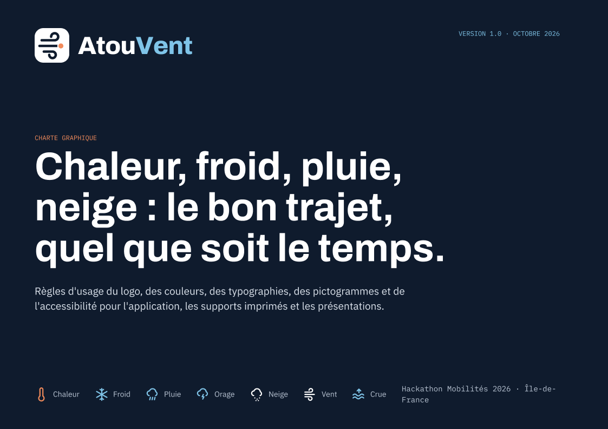
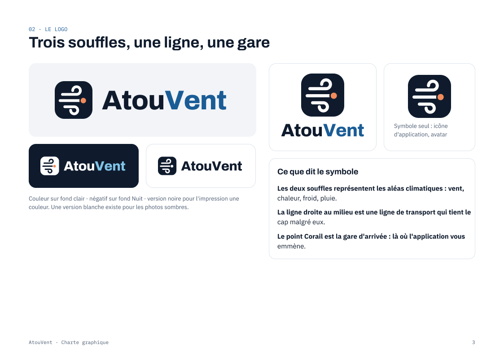
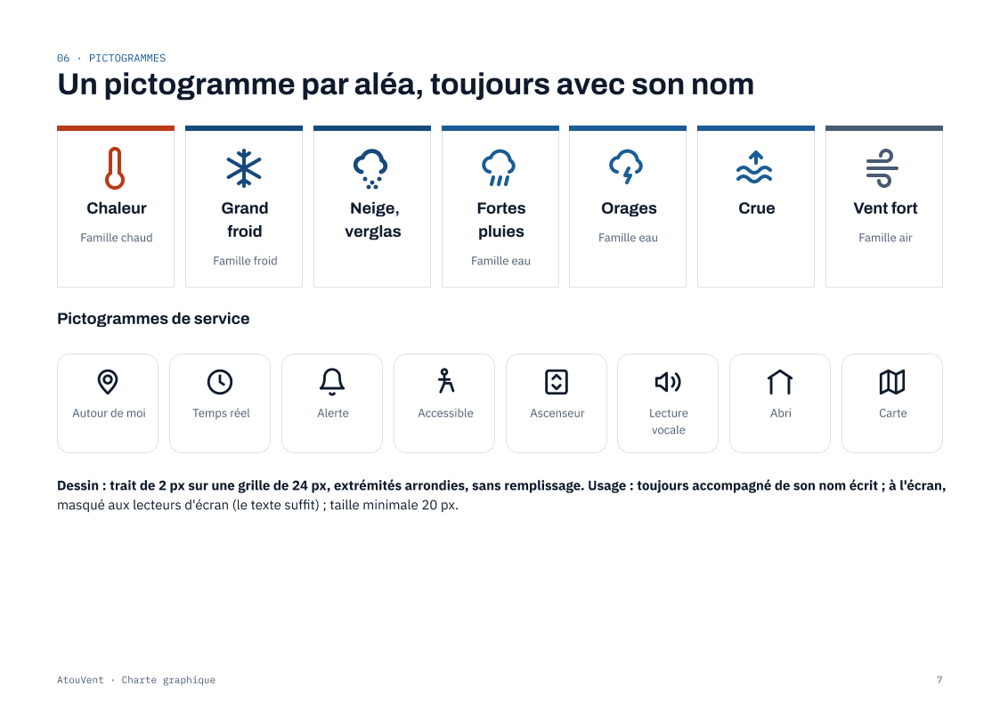
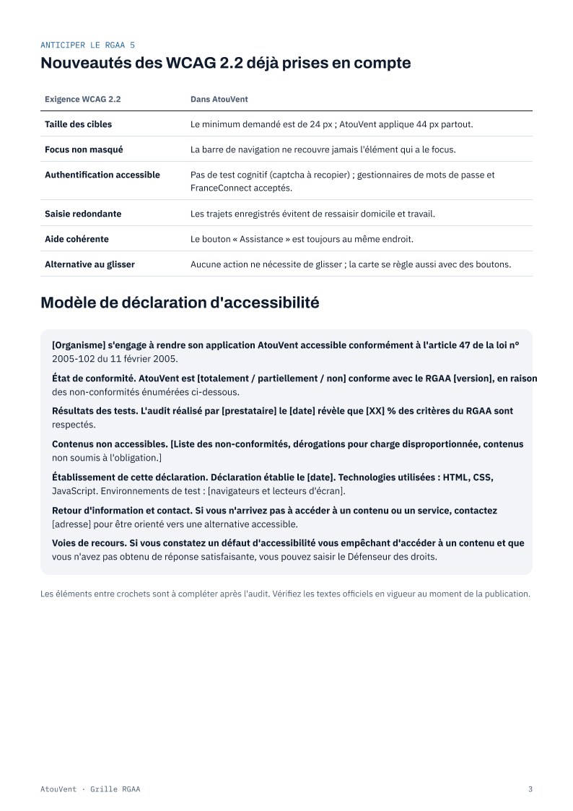
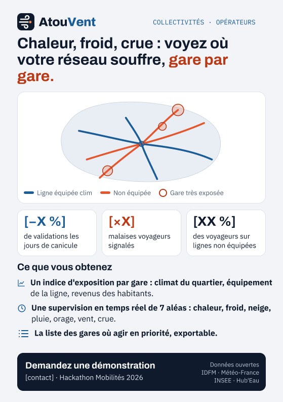
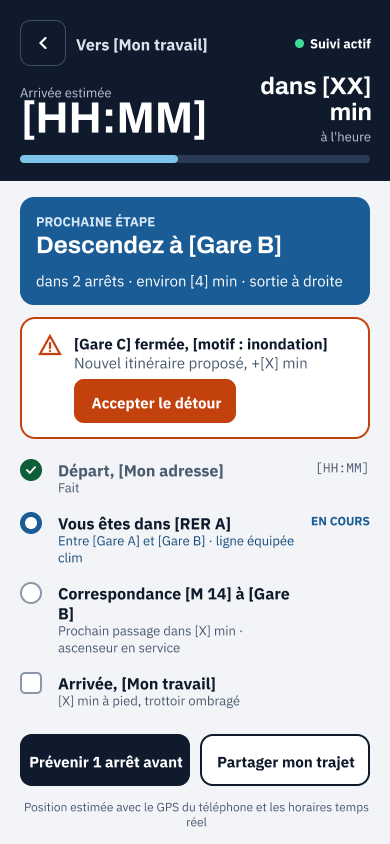
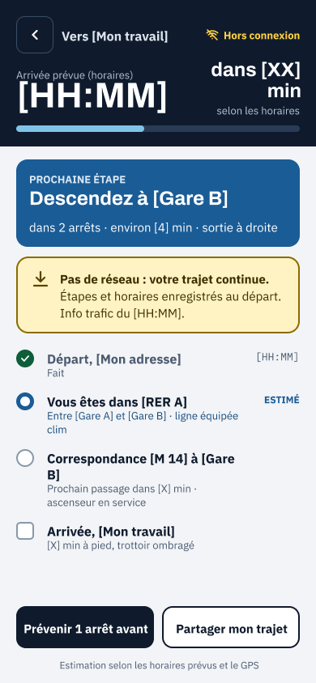
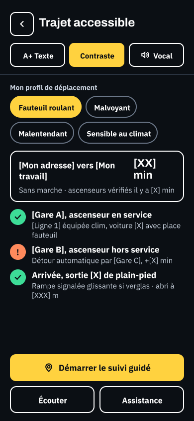

# Conception : charte graphique, maquette et flyers

Fichier Figma source : **[AtouVent · Charte, maquette et flyers](https://www.figma.com/design/HscfdE8mqzpNKNbZaySCkB/AtouVent-%C2%B7-Charte--maquette-et-flyers)**
(page « Charte graphique » : 13 planches de charte et RGAA, 3 flyers A5, 16 écrans de maquette).

La charte est appliquée dans le code par les jetons de `frontend/src/assets/scss/base/_tokens.scss` (couleurs, typographie,
espacements), les pictogrammes de `frontend/src/components/Icon.jsx` et le logo de `frontend/src/assets/img/`.
Chaque écran de l'application porte le numéro de son écran de maquette (00 à 11, voir le README principal).

Les images ci-dessous sont des exports PNG des cadres Figma (`figma/`), à la taille d'origine.

| Cadre Figma | Export |
|---|---|
| [Charte 01 · Couverture](https://www.figma.com/design/HscfdE8mqzpNKNbZaySCkB/AtouVent?node-id=11-2850) |  |
| [Charte 02 · La marque](https://www.figma.com/design/HscfdE8mqzpNKNbZaySCkB/AtouVent?node-id=11-2903) | à exporter |
| [Charte 03 · Le logo](https://www.figma.com/design/HscfdE8mqzpNKNbZaySCkB/AtouVent?node-id=11-3237) |  |
| [Charte 04 · Règles du logo](https://www.figma.com/design/HscfdE8mqzpNKNbZaySCkB/AtouVent?node-id=11-2728) | à exporter |
| [Charte 05 · Couleurs](https://www.figma.com/design/HscfdE8mqzpNKNbZaySCkB/AtouVent?node-id=11-3314) | à exporter |
| [Charte 06 · Typographie](https://www.figma.com/design/HscfdE8mqzpNKNbZaySCkB/AtouVent?node-id=11-3048) |  |
| [Charte 07 · Pictogrammes](https://www.figma.com/design/HscfdE8mqzpNKNbZaySCkB/AtouVent?node-id=11-3094) | à exporter |
| [Charte 08 · Composants](https://www.figma.com/design/HscfdE8mqzpNKNbZaySCkB/AtouVent?node-id=11-2965) | à exporter |
| [Charte 09 · Accessibilité](https://www.figma.com/design/HscfdE8mqzpNKNbZaySCkB/AtouVent?node-id=11-3461) | à exporter |
| [Charte 10 · RGAA, langues, hors ligne](https://www.figma.com/design/HscfdE8mqzpNKNbZaySCkB/AtouVent?node-id=11-3500) | à exporter |
| [RGAA 1 · Obligations](https://www.figma.com/design/HscfdE8mqzpNKNbZaySCkB/AtouVent?node-id=11-4032) | à exporter |
| [RGAA 2 · Les 13 thématiques](https://www.figma.com/design/HscfdE8mqzpNKNbZaySCkB/AtouVent?node-id=11-3646) | à exporter |
| [RGAA 3 · WCAG 2.2 et déclaration](https://www.figma.com/design/HscfdE8mqzpNKNbZaySCkB/AtouVent?node-id=11-3567) |  |
| [Flyer 1 · Grand public (A5)](https://www.figma.com/design/HscfdE8mqzpNKNbZaySCkB/AtouVent?node-id=11-3923) | à exporter |
| [Flyer 2 · Accessibilité (A5)](https://www.figma.com/design/HscfdE8mqzpNKNbZaySCkB/AtouVent?node-id=11-4266) |  |
| [Flyer 3 · Décideurs (A5)](https://www.figma.com/design/HscfdE8mqzpNKNbZaySCkB/AtouVent?node-id=11-4185) | à exporter |
| [00 · Choix de la langue](https://www.figma.com/design/HscfdE8mqzpNKNbZaySCkB/AtouVent?node-id=11-4112) | à exporter |
| [01 · Connexion](https://www.figma.com/design/HscfdE8mqzpNKNbZaySCkB/AtouVent?node-id=11-3865) | à exporter |
| [02 · Créer un compte](https://www.figma.com/design/HscfdE8mqzpNKNbZaySCkB/AtouVent?node-id=11-6224) | à exporter |
| [02b · Votre profil de déplacement](https://www.figma.com/design/HscfdE8mqzpNKNbZaySCkB/AtouVent?node-id=11-4415) | à exporter |
| [02c · Parcours après l'inscription](https://www.figma.com/design/HscfdE8mqzpNKNbZaySCkB/AtouVent?node-id=11-4656) | à exporter |
| [03 · Autour de moi](https://www.figma.com/design/HscfdE8mqzpNKNbZaySCkB/AtouVent?node-id=11-5114) |  |
| [03en · Around me](https://www.figma.com/design/HscfdE8mqzpNKNbZaySCkB/AtouVent?node-id=11-5254) |  |
| [04 · Choisir un itinéraire](https://www.figma.com/design/HscfdE8mqzpNKNbZaySCkB/AtouVent?node-id=11-4562) |  |
| [05 · Suivi du trajet](https://www.figma.com/design/HscfdE8mqzpNKNbZaySCkB/AtouVent?node-id=11-5029) | à exporter |
| [05b · Suivi du trajet hors connexion](https://www.figma.com/design/HscfdE8mqzpNKNbZaySCkB/AtouVent?node-id=11-4948) | à exporter |
| [06 · Accessibilité](https://www.figma.com/design/HscfdE8mqzpNKNbZaySCkB/AtouVent?node-id=11-4479) | à exporter |
| [07 · Mes alertes](https://www.figma.com/design/HscfdE8mqzpNKNbZaySCkB/AtouVent?node-id=11-4326) | à exporter |
| [08 · Mon compte](https://www.figma.com/design/HscfdE8mqzpNKNbZaySCkB/AtouVent?node-id=11-4789) | à exporter |
| [09 · Tableau de bord décideurs](https://www.figma.com/design/HscfdE8mqzpNKNbZaySCkB/AtouVent?node-id=11-5625) | à exporter |
| [10 · Supervision temps réel](https://www.figma.com/design/HscfdE8mqzpNKNbZaySCkB/AtouVent?node-id=11-5394) | à exporter |
| [11 · Prévision J+1 et risques](https://www.figma.com/design/HscfdE8mqzpNKNbZaySCkB/AtouVent?node-id=11-6291) | à exporter |

Pour compléter les exports : dans Figma, sélectionner les cadres « à exporter », Exporter > PNG 1x, et les enregistrer dans
`design/figma/` avec un nom en minuscules sans accents (par exemple `charte-05-couleurs.png`).

Licence : MIT comme le reste du projet (créations de l'équipe AtouVent).
