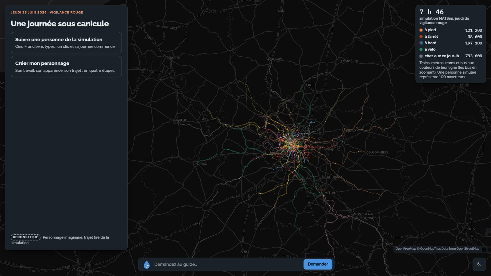
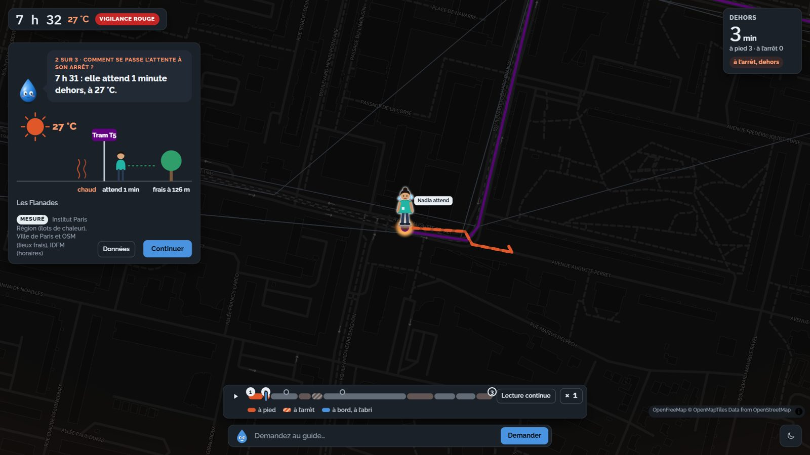
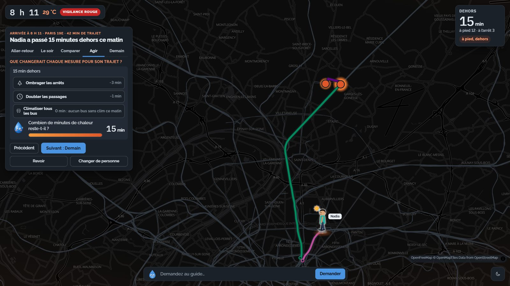

# Une journée sous canicule · Réseau sous canicule en Île-de-France

**Équipe :** TAMOVIZ · Yeltsin Valero, Caroline Prioton, Arthur Savi, Jorge Cabrera, Jérôme Voinot

**Mail(s) de contact :** yeltsin.valero@transamo.com, caroline.prioton@transamo.com, arthur.savi@transamo.com, jorge.cabrera@transamo.com, jerome.voinot@transamo.com

**Défi :** Défi 1 — Les mobilités et l’adaptation climatique

## Présentation du projet

Ce projet a été développé dans le cadre du Hackaviz Mobilités 2026 spécial dataviz, organisé par Île-de-France Mobilités du 2 au 26 novembre 2026.

### Notre question

Pendant une canicule, où les voyageurs des transports en commun franciliens sont-ils les plus exposés à la chaleur, qui renonce au transport et qui n’a pas le choix, et quelle mesure les protège le mieux ?

### Le problème et la proposition de valeur

Le 24 juin 2026, Paris-Montsouris relève 40,5 °C en pleine vigilance rouge. Pour un voyageur, la chaleur ne se vit pas seulement à bord : elle se vit à l’arrêt, en attendant au soleil, et sur les trajets à pied. Or ces minutes passées dehors ne sont visibles dans aucun indicateur de l’offre.

- **Problème :** les 17 458 zones d’arrêt de la région n’exposent pas toutes de la même façon (îlot de chaleur, ombre, fréquence, climatisation des bus), et les voyageurs n’ont pas tous la même marge d’adaptation (télétravail, horaires flexibles, revenus).
- **Usagers cibles :** les équipes d’Île-de-France Mobilités et des collectivités qui préparent les plans canicule, et le grand public, qui peut suivre une journée type et comprendre ce qui change pour lui.

### Notre visualisation

**Site en ligne :** <http://52.47.51.94/> (instance AWS de l’équipe)

**Code source :** dossier [`production/`](production/) (site statique dans `production/web/`, chaîne de calcul dans `production/scripts/`).

**Vidéo de démonstration (2 minutes) :** [`pitch/TAMOVIZ_demo.mp4`](pitch/TAMOVIZ_demo.mp4) : la question, les cartogrammes explorés, le parcours dans le site et les cinq critères du jury.

**Pitch :** [`pitch/TAMOVIZ_pitch.pdf`](pitch/TAMOVIZ_pitch.pdf) (support PowerPoint avec vidéo et animations dans le même dossier).

| Choisir une personne | Suivre sa matinée | Tester une mesure |
|---|---|---|
|  |  |  |

Un écran unique, « Une journée sous canicule » : on choisit une personne type tirée de la simulation multi-agents MATSim (ou on crée son personnage), puis on suit sa matinée du jeudi 25 juin 2026 sur la carte, minute par minute, avec un compteur de minutes passées dehors (à pied, à l’arrêt, à bord), quelques scènes dessinées et, à la fin, la comparaison des cinq personnes et de trois mesures à tester.

### La solution

1. **Où ?** Pour chaque zone d’arrêt, un indice d’exposition croise l’îlot de chaleur urbain (Institut Paris Région), l’ombre et les lieux frais à proximité (îlots de fraîcheur, parcs, fontaines), la fréquence de passage aux heures de pointe et la climatisation des lignes.
2. **Qui ?** Les validations quotidiennes du 2e trimestre 2026 sont confrontées aux jours de vigilance et aux températures observées, puis croisées avec le niveau de vie (Filosofi) et les déplacements domicile-travail et domicile-études (MOBPRO, MOBSCO 2021).
3. **Quelle mesure ?** Une simulation multi-agents MATSim (1 % de la population francilienne, GTFS IDFM) compare une journée ordinaire, une journée de canicule et trois mesures : bus climatisés, renfort de fréquence, horaires décalés. Cinq profils types en sont tirés pour raconter la journée.

Le site est entièrement statique (HTML, CSS, JavaScript, MapLibre) ; les itinéraires modifiés par l’utilisateur sont recalculés dans le navigateur (algorithme RAPTOR).

Méthodes et hypothèses détaillées : [`production/docs/methodologie.md`](production/docs/methodologie.md).

### Les problèmes surmontés et les enjeux en matière de données

- **Volume des données :** GTFS, îlots de chaleur (261 050 îlots) et carroyage Insee pèsent plusieurs gigaoctets ; nous les avons agrégés par zone d’arrêt et découpés pour que le site s’ouvre sans serveur applicatif.
- **Climatisation des véhicules :** l’attribut `air_conditioning` du référentiel des lignes est renseigné par ligne et non par véhicule ; nous recommandons à IDFM de publier la climatisation au niveau de la flotte ou de la course.
- **Fréquentation fine :** les validations sont journalières et par ligne ; une donnée horaire par arrêt permettrait de mesurer directement le report des déplacements pendant les heures chaudes.
- **Ombre aux arrêts :** il n’existe pas de jeu ouvert décrivant les abris et l’ombrage des points d’arrêt ; un attribut « abri / ombre » dans le référentiel des arrêts serait très utile.

### Les données utilisées

| Source | Jeu de données | Lien |
|---|---|---|
| Île-de-France Mobilités | Offre hebdomadaire moyenne, référentiels des arrêts et des lignes, gares, tracés, fontaines, accessibilité | <https://data.iledefrance-mobilites.fr> |
| Île-de-France Mobilités | Validations par jour, réseau ferré et réseau de surface (2e trimestre 2026) | <https://data.iledefrance-mobilites.fr> |
| Île-de-France Mobilités (PRIM) | GTFS IDFM, horaires prévus | <https://prim.iledefrance-mobilites.fr> |
| Institut Paris Région | Îlots de chaleur urbains, LCZ 2022 | <https://geoweb.iau-idf.fr> |
| Insee | Filosofi carroyé 200 m (2019) ; MOBPRO et MOBSCO 2021 ; flux de mobilité 2021 | <https://www.insee.fr> |
| IGN (Géoplateforme) | Contours IRIS | <https://data.geopf.fr> |
| geo.api.gouv.fr | Communes et arrondissements municipaux | <https://geo.api.gouv.fr> |
| Ville de Paris | Îlots de fraîcheur | <https://opendata.paris.fr> |
| Météo-France | Vigilance canicule ; observations horaires (base HOR) | <https://www.data.gouv.fr> |
| OpenStreetMap | Parcs et jardins ; réseau piéton (Geofabrik) | <https://www.openstreetmap.org> |

Liste complète, avec fichiers et usages : [`production/docs/sources.md`](production/docs/sources.md).

### Les outils employés

- Python (pandas, numpy, scipy, shapely, pyogrio, pyproj, pyarrow) pour la chaîne de calcul (`production/scripts/`)
- MATSim 15 (Java 17) pour la simulation multi-agents
- MapLibre GL JS, OpenFreeMap, HTML, CSS et JavaScript sans étape de build pour le site
- RAPTOR (implémentation JavaScript) pour le calcul d’itinéraires dans le navigateur

### Accessibilité

Prise en compte dès la conception, selon la checklist du Hackaviz :

| Point de la checklist | Ce que fait le site |
|---|---|
| Informations essentielles faciles à repérer | une question en titre par scène, la réponse en une phrase, un compteur unique « minutes dehors » toujours visible |
| Contrastes du texte et des pictogrammes | audit automatique axe-core 4.10 (WCAG 2.2 A et AA) : aucun défaut sur les 9 écrans testés (couverture, choix, scène, cinq pages de fin), mode sombre par défaut et mode clair au choix |
| Compréhensible sans la couleur | chaque état a aussi un motif ou un mot : marche en trait plein, attente en tirets, bus sans clim en tirets ; niveaux de preuve écrits en toutes lettres (Mesuré, Reconstitué, Projeté) avec bordure pleine, tiretée ou pointillée |
| Alternative aux images | chaque dessin a un texte alternatif, et chaque scène un bouton « Données » qui remplace le dessin par son tableau |
| Titres et légendes des graphiques | chaque graphique porte sa question en titre et une légende courte |
| Utilisable au clavier | tous les contrôles sont des boutons ; frise du trajet au clavier (flèches, Page précédente et suivante, Début, Fin), espace pour la pause, focus visible ; la carte, illustrative, est sautée |
| Autres | cibles d’au moins 24 px, aucune fermeture automatique des scènes, mouvement réduit si le système le demande, mise en page téléphone, tablette et ordinateur sans défilement |

### Ce que nous avons visé, critère par critère

| Critère du jury | Notre réponse |
|---|---|
| Pertinence et qualité visuelle | l’exposition se vit hors du véhicule (à pied, à l’arrêt) : un récit sur la carte, une question par scène, un seul chiffre à retenir |
| Données et traitements | dix producteurs de données ouvertes, une simulation MATSim de 1 % des Franciliens (télétravail calé sur les parts observées un jour ordinaire), trois niveaux de preuve affichés (Mesuré, Reconstitué, Projeté) |
| Documentation | sources tracées ([`sources.md`](production/docs/sources.md)), méthode pas à pas ([`methodologie.md`](production/docs/methodologie.md)), code commenté sous licence MIT |
| Pérennité et réutilisabilité | chaîne de calcul scriptée (de `01_download.py` à `19_ui_finale.py`) qui se relance avec de nouvelles données ; site statique sans serveur de calcul (environ 19 Mo compressés), trajets recalculés dans le navigateur |
| Accessibilité du service | voir le tableau ci-dessus |

### Et la suite ?

- Passer de 1 % à 10 % de la population simulée et caler la simulation sur des validations horaires.
- Ajouter l’ombre réelle aux arrêts (relevés terrain ou modèle d’ombrage à partir du bâti).
- Proposer l’outil aux équipes d’IDFM comme aide à la priorisation des arrêts à équiper (abris, brumisateurs, renforts de fréquence) avant l’été.

## Installation et utilisation

Toutes les données du site sont déjà dans `production/web/data/`. Depuis le dossier `production/` :

```bash
python -m http.server 8765 -d web
```

puis ouvrir <http://localhost:8765>. Une connexion internet est nécessaire pour le fond de carte, MapLibre et les polices. Pour refaire les calculs, voir [`production/README.md`](production/README.md).

## Licence

Ce projet est publié sous licence MIT pour le code et la documentation (voir [`LICENSE`](LICENSE)), sous CC-BY 4.0 pour les textes et visuels. Les données gardent la licence de leur producteur (Licence Ouverte Etalab 2.0 ou ODbL).

